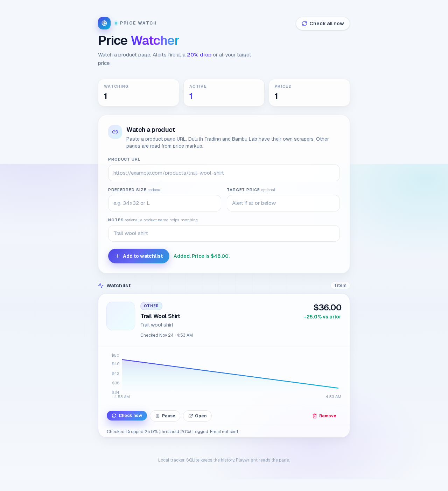
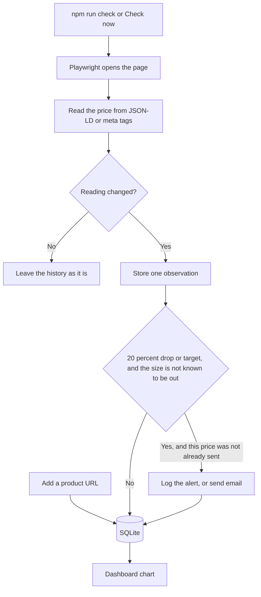

# Price Watcher

I wanted to know when things I buy drop in price, without opening the product page myself.

This runs on your machine. There is no hosted demo. Playwright needs a process that can stay up, and the price history is a SQLite file. A serverless host stops the scrape at a time limit. It also has nowhere durable to keep that file.

## What I built

Price Watcher watches a product URL. It reads the page, stores each new price, and shows the history on a chart.

An alert fires when the price falls by 20 percent from the previous reading, or when it hits a target price you set. If you set a size and that size is out of stock, it does not alert. The same price does not add another history row, and it does not alert again.

Duluth Trading and Bambu Lab have their own scrapers. Any other product page is read from its JSON-LD and meta tags.



A short recording of that run is in [docs/check.gif](docs/check.gif). The empty list, the first price, and a narrow view are in `docs/dashboard-empty.png`, `docs/dashboard-first-price.png`, and `docs/dashboard-mobile.png`.

## How it works



`npm run check` walks every active product. One failed page is recorded on that product and the rest of the run continues. `--dry-run` records the alert and does not call Resend. That record counts for the price, so a later check does not email the same price again.

## Tech stack

- TypeScript
- Next.js and React
- Tailwind CSS
- SQLite through better-sqlite3 and Drizzle
- Playwright
- Zod, for the add-product form and environment values
- Recharts, for the price chart
- Resend, for email when you set a key

## Run locally

You need Node 20 or newer. These steps were run on Node 22.

```bash
npm install
npx playwright install chromium
cp .env.example .env.local
npm run dev
```

Open http://localhost:3000 and paste a product URL.

```bash
npm test
npm run lint
npm run typecheck
npm run build
npm run check -- --dry-run
```

`npm run check` only checks products you have already added.

Docker uses the Playwright image and listens on port 3000.

```bash
docker build -t price-watcher .
docker run --rm -p 3000:3000 \
  -e PW_CHANNEL=chromium \
  -e DATA_DIR=/tmp/price-watcher-data \
  price-watcher
```

The SQLite file inside that container lives under `DATA_DIR`. It is gone when the container is removed, unless you mount a directory there.

## Configuration

Copy [.env.example](.env.example) to `.env.local`.

| Variable | What it does |
| --- | --- |
| `RESEND_API_KEY` | Sends alert email when set. Leave it empty and the alert is only logged. |
| `ALERT_EMAIL` | Inbox for alerts. Required when `RESEND_API_KEY` is set. |
| `ALERT_FROM` | From address. The default is Resend's onboarding sender, and that sender only delivers to the Resend account address. |
| `ALERT_DRY_RUN` | Set to `1` to record the alert and skip Resend. |
| `APP_PASSWORD` | Optional password for the web UI. Leave it empty for no login. |
| `SESSION_SECRET` | Signs the login cookie when `APP_PASSWORD` is set. At least 16 characters. The cookie stores that signature and an expiry, not the password. It is httpOnly, SameSite lax, and Secure in production. |
| `DATA_DIR` | Directory for `price-watcher.db`. The default is `./data`. |
| `PW_CHANNEL` | `chromium` or `chrome`. Docker should use `chromium`. |

A bad email, an unknown `PW_CHANNEL`, or a password without a long enough `SESSION_SECRET` stops the check with an error before any page is opened.

## Tests

`npm test` checks three things.

- Prices parsed from fixture HTML, including a page that also shows a shipping price.
- When a drop, a target price, or an out-of-stock size should alert.
- A repeated reading does not add a row or a second alert, and a failed send can be retried once.
- A correct password sets a signed cookie that the gate accepts. A wrong password, a tampered cookie, and an expired cookie do not.

The tests do not launch a browser. The browser run is the one written up in [docs/check-run.txt](docs/check-run.txt).

## What I learned

A scheduled check has to finish the list. If one page throws, that product gets an error and the next product still runs.

Re-running a check used to append the same price and could alert on every run while a target stayed hit. The check now compares the new reading with the latest stored one. It writes a row only when the price, stock, size, or error changed. It sends an alert once per price, and retries that send only when the previous attempt failed.

The first dollar amount on a page is often shipping or a related item. The parser uses JSON-LD and the product meta tags before that. A bare `$12` with no cents is ignored.

Headless Chromium can open a public page and still have nothing to store. books.toscrape.com loaded, and the title came back, but the price is in pounds and the page has no product JSON-LD. The screenshots use a local product page on this machine so the history and the alert are real. See [docs/check-run.txt](docs/check-run.txt).

Duluth Trading often blocks a bare browser. That scraper uses the store's product API and rejects a weak name match. I left that matcher as it was.

Returning to a price you were already emailed about does not send a second email. A drop that happens while the preferred size is out of stock is not replayed later as a percentage drop, because the stored price has already moved. A later reading can still alert if it hits the target.

## Built with AI

I directed this in Cursor, with Grok. I set the alert rules, checked the scrapers against pages, and kept the behavior that the tests and the local run showed.
